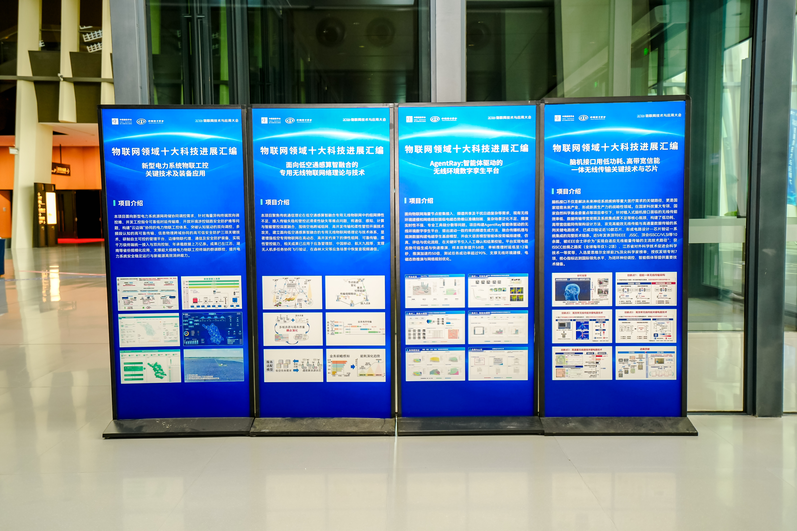
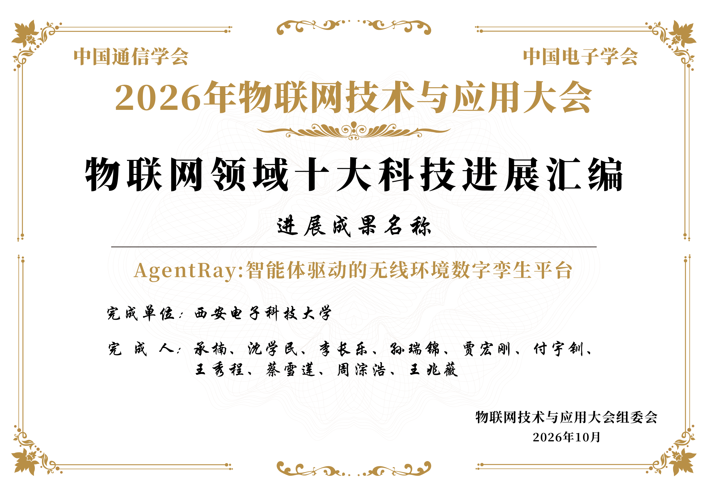

喜讯｜AgentRay:首个智能体驱动的无线环境孪生与智能网络决策平台入选物联网领域十大科技进展

<!--more-->

2026 年 10 月，由中国通信学会、中国电子学会共同主办的 2026 年物联网技术与应用大会召开。会上公布了 2026 年物联网领域十大科技进展评选结果。团队承楠教授牵头完成的 <strong>“AgentRay：智能体驱动的无线环境数字孪生平台”</strong>成功入选，并收录于《物联网领域十大科技进展汇编》。

---

## AgentRay：首个智能体驱动的全流程无线环境孪生与智能网络决策平台

物联网海量节点密集接入、频谱共享，干扰日趋复杂，可靠连接保障面临挑战。问题落到无线环境建模与网络规划环节，表现得更加具体：电磁态势难以准确刻画、复杂场景泛化不足、推演实时性不强、专业工具链分散。

针对这些难题，团队构建了<strong>AgentRay</strong>。平台面向复杂无线场景，把“环境建模—电磁态势推演—系统评估—方案优化”串联为完整链路，推动网络规划与运维从事后处置转向事前优化。

## 三项关键技术支撑“可信、实时、可用”

围绕可信、实时、可用三个科学问题，团队形成了三项相互支撑的核心技术。

**波动一致约束的频谱孪生可信生成。** 团队揭示高维频谱态势的低维可学习结构，将波动物理约束引入生成模型，在降低样本依赖的同时保障生成结果的物理可信性，样本效率提升 58 倍。

**电磁孪生基座大模型与高效推理。** 融合传播机理与观测数据构建孪生基座模型，以观测约束下的后验校准保障精度、以隐空间复用提升效率，单帧推理时延低至 12 毫秒，推演加速约 50 倍。

**大语言模型驱动的可控智能体仿真编排。** 将产业需求解析为任务目标与执行约束，由智能体按需编排建模、仿真、评估与优化工具链，并在关键环节引入人工确认与结果校验，测试任务成功率超过 90%。

三项技术最终集成于 AgentRay 平台，形成面向无线环境建模、电磁态势推演与网络规划优化的完整能力。

## 从科研成果到真实场景

目前，相关成果已在鹏城实验室、中国铁塔、中电科三十六所等单位开展集成应用，并为华为电磁态势地图项目提供技术支撑。

此前，团队相关成果曾入选 2025 年度电磁频谱领域十大科技进展；基于该平台的作品获第二十一届中国研究生电子设计竞赛华为 6G 先进无线技术探索专项赛全国一等奖。此次入选物联网领域十大科技进展，是团队在电磁空间智能孪生方向持续深耕的又一阶段性成果。

## 完成单位与完成人

**完成单位：** 西安电子科技大学

**完成人：** 承楠、沈学民、李长乐、孙瑞锦、贾宏刚、付宇钏、王秀程、蔡雪莲、周淙浩、王兆薇

*图 2　AgentRay 平台亮相大会“物联网领域十大科技进展汇编”展区*

*图 3　2026 物联网领域十大科技进展入选证书*

---

**相关链接**

- 团队主页：https://unic.xidian.edu.cn/
